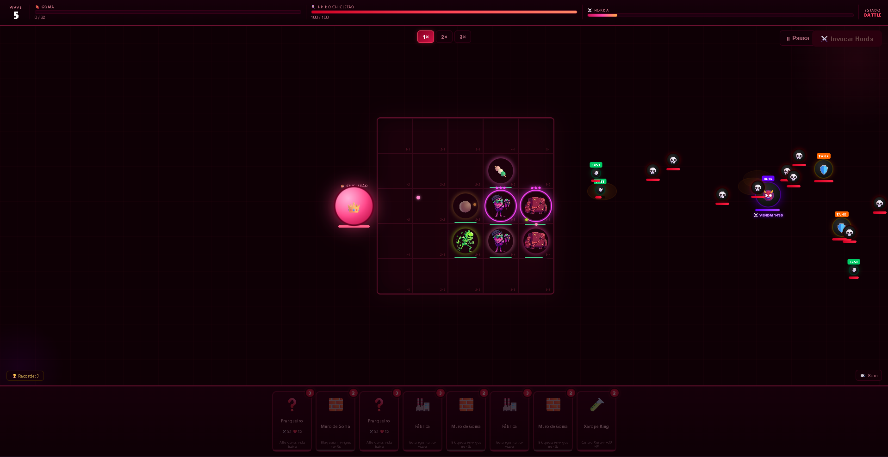

# Reino do Chicletão 🍬



## Descrição

Jogo de tower defense baseado em cartas: defenda o Rei Chicletão posicionando tropas num grid 5x5 contra hordas de inimigos (Venom). Gerencie sua goma, invoque unidades, sobreviva o maior número de waves possível e tente bater seu recorde.

Desenvolvido como Trabalho de Conclusão de Curso (TCC) — ETEC Desenvolvimento de Games 2D/3D.

---

## Como executar

Abra o arquivo `Jogo.html` em um navegador moderno (Chrome/Edge/Firefox) com zoom em **100%** (Ctrl+0). Não requer servidor — basta dar duplo-clique no arquivo.

> ⚠️ Mantenha o arquivo `Jogo.html`, `script.js`, `style.css` e as imagens **na mesma pasta**.

---

## Controles

| Ação | Controle |
|---|---|
| Selecionar carta | Clique na carta da mão |
| Posicionar tropa | Clique numa célula do grid |
| Fazer upgrade de tropa | Clique na célula com a mesma carta |
| Iniciar wave | Botão **Invocar Horda** |
| Pausar | **P** ou **Espaço** |
| Resetar velocidade | **Ctrl+0** (zoom 100%) |

---

## Mecânicas de jogo

### Tropas (cartas de unidade)
| Carta | Custo | Passiva |
|---|---|---|
| Mascador 🍬 | 2 | Regenera HP das tropas vizinhas |
| Chicle Ácido 🍋 | 2 | — |
| Blocão 🛡 | 4 | **Taunt** — inimigos priorizam ele |
| Franqueiro 🎯 | 3 | **Crítico** — 20% chance de dano duplo |
| Par de Goma 🍡 | 2 | — |
| Rei da Bala 🍮 | 4 | Lendário (raridade especial) |
| Goma Grudenta 🟤 | 5 | Lentifica inimigos automaticamente |
| Chicle Cura 💚 | 3 | Cura tropas aliadas próximas |

### Tipos de inimigo
| Inimigo | Comportamento |
|---|---|
| Normal 💀 | Padrão |
| Tank 🛡️ | Muito HP, lento |
| Fast 💨 | Pouco HP, muito rápido |
| Boss 👹 | Entra em fúria a 40% HP, se divide em 3 ao morrer |
| Curador 💊 | Heala aliados próximos — prioridade de abate |
| Corredor 🏃 | Ignora tropas, vai direto no Rei (wave 6+) |
| Armado 🪖 | Primeiro hit quebra o escudo (wave 8+) |

### Outros sistemas
- **Sinergias** — quanto mais tropas no grid, maior o bônus de dano coletivo
- **Combo** — matar 3+ inimigos seguidos ativa multiplicador de score
- **Fábrica 🏭** — gera goma extra por wave
- **Loja** — aparece a cada 3 waves para comprar itens com goma
- **Upgrades pós-wave** — escolha 1 de 3 power-ups ao fim de cada wave
- **Eventos especiais** — Horda Dupla, Horda Veloz, Curador em campo
- **Conquistas** — 12 conquistas salvas localmente
- **Histórico** — últimas 5 partidas salvas com wave, score e kills

---

## Velocidade

Use os botões **1× 2× 3×** na arena para acelerar o jogo.

---

## Estrutura do projeto

```
chico-cletus_game-main/
├── Jogo.html           — estrutura HTML da página
├── script.js           — lógica completa do jogo
├── style.css           — estilos e animações
├── chicleteMascador.png
├── chicleteAcido.png
├── chicleteTanque.png
├── Franqueiro.png
├── sprites.jpg
├── boss-screenshot.png
└── README.md
```

---

## Tecnologias

- HTML5, CSS3, JavaScript puro (sem frameworks ou bibliotecas)
- Renderização via DOM (sem Canvas)
- Web Audio API para efeitos sonoros procedurais
- localStorage para high score, conquistas e histórico de partidas

---

## Equipe

Desenvolvido por Raul Pinheiro das Chagas (R7Chaca) e colaboradores — ETEC, 2025.

---

## Licença

MIT
